# CoopUQ: Robust Multi-Robot Social Navigation via Uncertainty-Aware Cooperative Forecasting


[](https://2026.corl.org/)
[](https://coopuq.github.io/)

[](https://tasl-lab.github.io/)

[Zehao Wang](https://zehaowang983.github.io/)<sup>1</sup>, [Jianpeng Yao](https://jianpengyao.github.io/)<sup>2</sup>, [Yuping Wang](https://www.linkedin.com/in/yuping-wang-5a7178185/)<sup>3</sup>, [Yiping Li](https://camis-uga.github.io/lab/)<sup>4</sup>, [Jiaqi Li](https://songard.github.io/)<sup>5</sup>, [Zhixu Li](https://www.cs.ucr.edu/~zli538/)<sup>2</sup>, [Kanghoon Lee](https://www.linkedin.com/in/kanghoon-lee-675053204/)<sup>6</sup>, Jinfeng Wang<sup>2</sup>, [Cong Liu](https://intra.ece.ucr.edu/~cong/)<sup>2</sup>, [Zhaowei Tan](https://cs.ucr.edu/~ztan/index.html)<sup>2</sup>, [Jinkyoo Park](https://silab.kaist.ac.kr/)<sup>6</sup>, [Jiachen Li](https://jiachenli94.github.io/)<sup>1\*</sup>

<sup>1</sup>Georgia Institute of Technology &nbsp; <sup>2</sup>University of California, Riverside &nbsp; <sup>3</sup>University of Michigan &nbsp; <sup>4</sup>University of Georgia &nbsp; <sup>5</sup>New York University &nbsp; <sup>6</sup>KAIST &nbsp; <sup>\*</sup>Corresponding author

---

## Abstract

Reinforcement learning enables mobile robots to make fast and scalable navigation decisions in constrained human-shared environments. However, directly extending single-robot approaches to multi-robot settings often fails to ensure safety and efficiency, especially under occlusions and out-of-distribution (OOD) scenarios, where individual robots may overlook potential risks or make inaccurate predictions.

We propose **CoopUQ**, a multi-robot social navigation framework that bridges uncertainty-aware cooperative occupancy forecasting and robust decision making. CoopUQ predicts future occupancy grid maps (OGMs) through cross-robot spatiotemporal feature fusion and further leverages forecasts and their uncertainty to guide the policy via constrained multi-agent reinforcement learning, where the cost penalizes navigation through regions predicted to be occupied or highly uncertain.

---

## Key Features

- **Cooperative OGM forecasting** — Each robot encodes its LiDAR history into a spatiotemporal feature and shares it with neighboring robots, so that forecasts cover regions a single robot cannot see.
- **Cross-robot spatiotemporal fusion** — Neighboring features are aligned to the ego frame and fused by cross-agent spatial attention and multi-head self-attention.
- **Stochastic forecasting with uncertainty** — A VAE decodes the future OGMs non-autoregressively; multiple samples give the predicted OGMs and their uncertainty maps.
- **Constrained multi-agent RL** — A shared MAPPO-Lagrangian policy is constrained by a cost that penalizes entering regions predicted to be occupied or highly uncertain.

---

## Method Overview

<p align="center">
  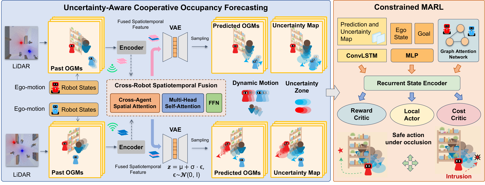
</p>

Each robot converts its LiDAR history into past OGMs and shares the encoded spatiotemporal feature with the other robots. The fused feature is decoded by a VAE into future OGMs and an uncertainty map, which the constrained multi-agent policy uses both as observation and to define its cost.

---

## Simulation Environments

<p align="center">
  
</p>

`simulator/` is a Unity3D project that builds scenes from a text description, with any
layout and any number of robots and pedestrians; see [simulator/README.md](simulator/README.md).

### Visualization

Visualize navigation trajectories from above:

```bash
bash onpolicy/scripts/visualize.sh iid iid.mp4      # iid, ood, ood_faster or ood_denser
```

<p align="center">
  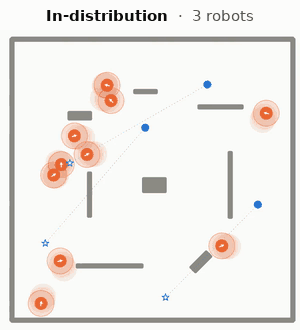
  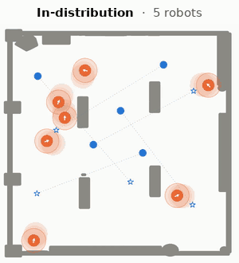
  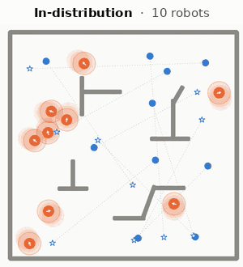
</p>
<p align="center">
  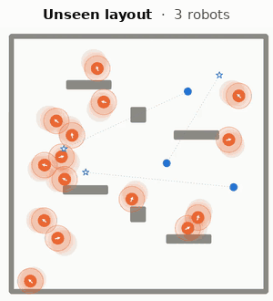
  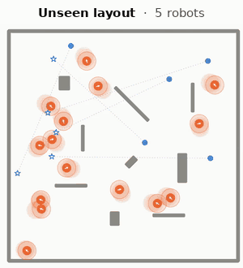
  
</p>
<p align="center">
  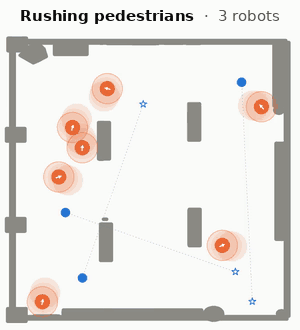
  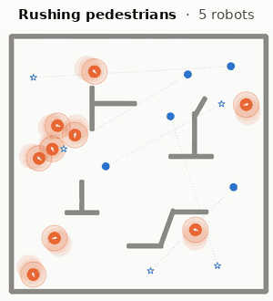
  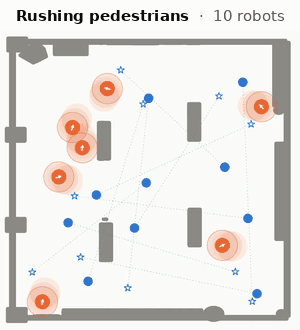
</p>
<p align="center">
  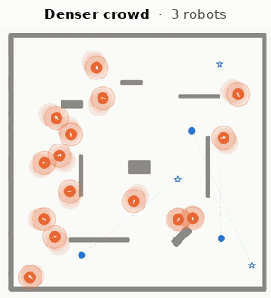
  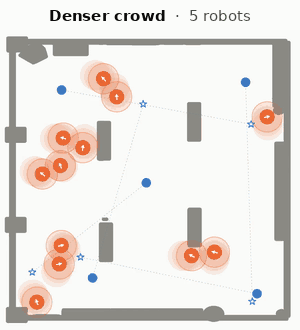
  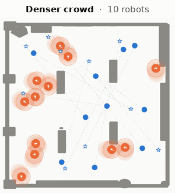
</p>

<p align="center">
  
</p>

---

## Environment Setup

- [Directory Structure](#directory-structure)
- [Installation](#installation)
- [Evaluation](#evaluation)
- [Common Issues](#common-issues)

---

## Directory Structure

```
CoopUQ/
├── predictor/                  # Cooperative OGM forecaster
│   ├── scripts/                #   Model arch
│   └── checkpoints/            #   Checkpoint
├── onpolicy/                   # Constrained multi-agent RL
│   ├── algorithms/             #   MAPPO-Lagrangian and networks
│   ├── runner/                 #   Rollout, cost computation, evaluation loop
│   ├── envs/                   #   Unity3D simulator interface
│   ├── utils/                  #   Buffers, value normalization, LiDAR-to-OGM
│   ├── scripts/                #   Evaluation scripts
│   └── checkpoints/            #   Checkpoint
├── simulator/                  # Unity3D project that generates simulation scenes
├── unity_envs/                 # Unity3D simulator builds (downloaded separately)
```

---

## Installation

### 1. Create the Conda Environment

```bash
conda create -n coopuq python=3.10
conda activate coopuq
```

### 2. Install the Dependencies

```bash
pip install -r requirements.txt
pip install -e .
```

The code was tested with Python 3.10, PyTorch 2.6, NumPy 1.23, Gym 0.26 and `mlagents-envs` 1.2.

### 3. Set Up the Simulator

Download the Unity3D builds from [Hugging Face](https://huggingface.co/datasets/tasl-lab/CoopUQ-unity-envs)
and unpack them in the repository root (see [unity_envs/README.md](unity_envs/README.md) for the builds):

```bash
pip install -U huggingface_hub
hf download tasl-lab/CoopUQ-unity-envs CoopUQ_unity_envs.tar.gz --repo-type dataset --local-dir .
tar -xzf CoopUQ_unity_envs.tar.gz      # extracts into unity_envs/
chmod +x unity_envs/*.x86_64
```

### 4. Verify Installation

```bash
python -c "import torch; print('PyTorch:', torch.__version__); print('CUDA:', torch.cuda.is_available())"
python -c "import onpolicy, predictor, mlagents_envs; print('CoopUQ OK')"
```

---

## Evaluation

Evaluate on all four settings:

```bash
bash onpolicy/scripts/eval.sh
```

Evaluate selected settings, or change the seed, the number of evaluation rounds and the simulator port:

```bash
bash onpolicy/scripts/eval.sh iid ood_denser
SEED=2 EPISODES=24 BASE_PORT=19006 bash onpolicy/scripts/eval.sh
```

Print the summary of finished evaluations again:

```bash
python onpolicy/scripts/eval/summarize_eval.py
```

---

## Common Issues

**The simulator does not start / `UnityTimeOutException`**
- Make sure the builds are executable (`chmod +x unity_envs/*.x86_64`) and that `UnityPlayer.so` is in `unity_envs/`.
- A previous run may still hold the port; use another one with `BASE_PORT=<port>`.

**`evaluation failed`**
- The full log of each setting is in `results/log_<setting>_seed_<seed>.log`.

**`numpy` errors on import**
- The code requires `numpy<2.0`; reinstall with `pip install "numpy<2.0"`.

---

## Acknowledgements

We sincerely thank the researchers and developers for [MAPPO](https://github.com/marlbenchmark/on-policy), [MACPO / MAPPO-Lagrangian](https://github.com/chauncygu/Multi-Agent-Constrained-Policy-Optimisation), [SOGMP](https://github.com/TempleRAIL/SOGMP), and [Unity ML-Agents](https://github.com/Unity-Technologies/ml-agents) for their amazing work.

---

## Citation

If you find this work useful, please cite:

```bibtex
@inproceedings{wang2026coopuq,
  title     = {CoopUQ: Robust Multi-Robot Social Navigation via
               Uncertainty-Aware Cooperative Forecasting},
  author    = {Wang, Zehao and Yao, Jianpeng and Wang, Yuping and
               Li, Yiping and Li, Jiaqi and Li, Zhixu and Lee, Kanghoon and
               Wang, Jinfeng and Liu, Cong and Tan, Zhaowei and
               Park, Jinkyoo and Li, Jiachen},
  booktitle = {10th Conference on Robot Learning (CoRL)},
  year      = {2026}
}
```

<p align="center">
  <a href="https://tasl-lab.github.io/">
    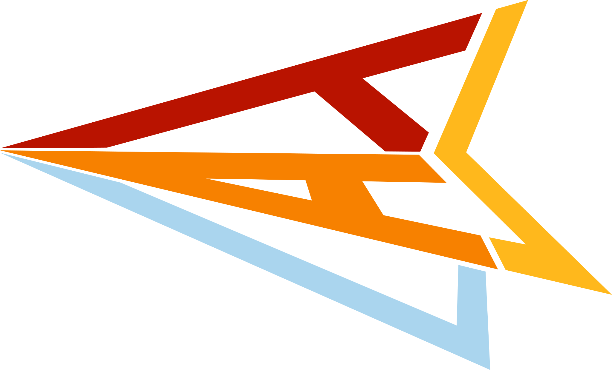
  </a>
  &nbsp;&nbsp;
  <a href="https://tasl-lab.github.io/">More Works from TASL</a>
</p>
